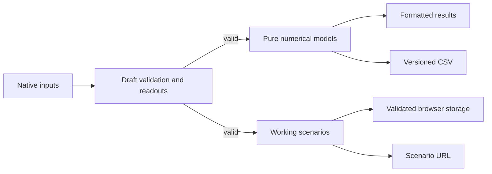

# Architecture and maintenance

Carbon Commons is a browser-local educational calculator. It has no account system, application backend, database server, or live emissions-data feed. The two domain models remain independent: a business investment does not use the household policy response equation.

## Follow one change through the application

1. `index.html` loads the app as an ES module. `app.js` reads the route and builds the selected lab from the current workspace.
2. `form.js` reads the native controls as a **draft**. It updates slider readouts immediately, associates invalid controls with the error message, and reports validity without saving anything.
3. An invalid draft leaves the last valid result visible with an explicit notice. Save, export, and share actions are disabled until the draft is valid.
4. A valid draft is checked by `business.js` or `model.js`, then committed through `workspace.js`. The app rerenders results from that valid input, not from partially edited text.
5. `format.js` controls display rounding, signs, units and the distinction between genuine zero and small nonzero values. It does not change model inputs or CSV precision.
6. CSV exporters recompute from validated inputs rather than trusting editable result objects or labels. Both exporters include the release identifier from `version.js`; it must match `package.json`.

## State and ownership

`state.js` validates the complete version-1 storage shape and shared-link inputs. It returns valid records that can be recovered, a warning, and `requiresRecovery` if anything was unreadable, dropped, repaired, or unrecognized. Reading never writes a repaired payload back.

`workspace.js` owns persistence decisions. The visible working scenario can remain stable while another tab updates browser storage. Before an ordinary write, it reads the latest valid stored snapshot and applies only the relevant lab or saved-card operation. Thus changing business revenue does not overwrite a newer policy scenario, and saving/removing a card does not blindly replace another tab's card list.

Unreadable data and failed writes stop automatic persistence. Further edits and saved cards remain in memory; the previous stored value is preserved. The recovery button explicitly replaces browser data with the valid current session, including any newer changes from another tab. Export or copy anything important before using it. A successful recovery clears the warning; a failed recovery keeps the session and a storage warning and returns focus to the recovery button. Another tab repairing storage does not automatically resume saving in a paused tab: its local work is retained until explicit recovery or reload.

This is browser storage, not a transactional collaboration system. Very close simultaneous writes can still use last-writer-wins behavior, especially for the same field. There is no cross-device sync. The app does not discard an active form in response to another tab's storage event.

## Presentation and navigation

- HTML interpolation of stored names and IDs is escaped. Numerical inputs are validated before rendering.
- Both data tables expose named, focusable scroll regions. Mobile metric cards stack instead of shrinking critical result text; paired monetary inputs stack on narrow phones so their amounts remain readable.
- Invalid fields point to the explanatory error. The last valid results are explicitly marked until the draft is repaired.
- Imported slider values retain their original precision until changed. The first arrow key moves in the requested direction to the next supported increment. Each slider also tracks its previous draft value so a native input change, including an accessibility value change, cannot reverse direction when snapped to the supported grid. The incoming value is captured before assigning a numeric step, which may sanitize the control immediately.
- Navigation cancels pending result announcements and clipboard fallback UI. A delayed clipboard failure cannot open a stale copy field on another route.
- A clipboard fallback has an accessible name; Escape closes it and returns focus to the copy action.
- Local font files retain the existing typography. `fonts/SOURCES.json` records the upstream URLs and hashes; the family-specific licenses travel with the files.

## Boundaries to preserve

Keep numerical models pure and free of DOM or storage access. Add new inputs to model validation, form controls, shared-link/state validation, exports, examples and tests together. Do not infer real country or company data from the hypothetical presets.

Calculate small deltas directly where subtraction of large near-equal totals would erase them. Do not use a fixed dollar floor to turn real gains/losses into zero. Use scale-aware tolerances for floating-point accounting identities, and keep exact zero/full-reduction endpoints explicit.

Do not convert invalid browser records into a silently persisted default session. Do not claim a successful save when storage rejected the write. A version change needs matching package and export metadata.

The local preview server is a development tool bound to loopback. It validates lexical and canonical paths so a public-directory symlink cannot expose a sibling private file. Public hosting serves only `dist/`; the development server is not an application backend.

## Verification

Run `npm test` and `npm run check` from the repository. Tests cover independently calculated model examples, numerical edge cases, CSV fidelity/version metadata, strict state validation, explicit storage recovery, multi-tab reconciliation and preview-server containment. The UI event tests use a small DOM port to exercise real handlers; they are not a layout or native-browser emulator.

For UI changes, also use the actual browser: edit an input to an invalid draft, move a slider, repair the input, save/load/remove a case, export CSV, copy a link, change labs, and navigate by keyboard. Check both 320px and 375px layouts, focusable horizontal tables, readable labels, and console errors. Verify remote and local deployment assets after release. These checks complement independent Claude review; neither model review nor passing unit tests replaces the browser pass.
